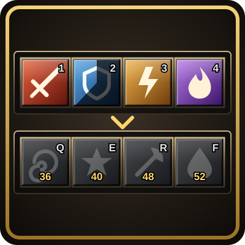

<h1 align="center">BarPlan</h1>

<b>Your action bars as a plan: set up every new character of a class the same way, spells you haven't learned yet included.</b> 
A WoW Forever addon.

<a href="https://github.com/zmann85/BarPlan/releases/latest"><b>⬇️ Download the latest version</b></a> &nbsp;·&nbsp; <a href="CHANGELOG.md">What's new</a>

## Install
1. Open the [latest release](https://github.com/zmann85/BarPlan/releases/latest) and download the `BarPlan-…zip` file under **Assets**.
2. Unzip it into `World of Warcraft\_classic_beta_\Interface\AddOns\` (you should end up with an `AddOns\BarPlan` folder).
3. Start the game or type `/reload`.

To update, repeat this and replace the old folder. Your plans are kept.

## What it does
Your action bars as a plan. Set up one character's bars the way you like them, save them as a named plan, and
a new character of that class gets the same bars, including the spells it hasn't learned yet. Each spell goes onto its
button the moment you learn it, and a new rank replaces the old one on the same button.

No placeholder macros needed: a spell button waits empty until you learn the spell. A macro that only casts one
spell (`#showtooltip X` / `/cast X`) is saved as that spell, so you can keep such placeholders on the character
you save from (for spells it can't learn yet) and new characters get the plain spell. Macros with logic in them
(stance swaps, mouseover, /startattack) are part of the plan too and are made on the new character when it
doesn't have them.

## Use

`/barplan` or the minimap button opens the window.

1. **Save your bars:** on a character whose bars are done, type a name (default: your class) and click Save.
   Plans belong to the class they were saved on: a warrior's plans are only offered to warriors.
2. **On a new character** of that class, BarPlan asks at the first login, with your class's plans in a dropdown
   (the one marked for new characters chosen). Or pick one in the window and click Apply (twice: it clears the
   buttons the plan has empty). What you know goes on now, the rest as you learn it.
3. **Play.** Learned spells go onto their buttons (after the fight when you learn one in combat).

**Addons too.** A plan keeps which addons were on when you saved it. Applying it switches this character's addons
to match and offers a reload, since the game only loads or unloads addons then. Addons you installed after saving
the plan are left as they are, and addons the plan had on but you don't have installed are listed. A plan saved
before BarPlan 1.4 has no addon list: save it again on its character to add one.

**Chat tabs too.** A plan keeps your chat tabs: each tab's name, which message types and channels it shows, its
font size, colour and place in the dock. Applying it sets General and Combat Log up the same, opens the tabs you
added (matched by name), and closes added tabs the plan doesn't have. Where the chat window sits stays as it is.

**Keybindings too.** A plan saved on a character with its own keybindings (the "character specific" box in the
game's keybinding options) keeps every key and what it does, macros and addon buttons included. Applying it
gives the new character those keys as its own set. A plan saved on a character using the account-wide keys
gives the new character the account-wide keys.
The window also has a **Character specific keybindings** switch that shows and changes it for the character
you're on, like the box in the game's keybinding options: on gives it its own set (a copy of the keys it has
now), off goes back to the account-wide keys.

All three are on by default; each has an On/Off switch in the window (or `/barplan addons on|off`, `/barplan chat
on|off`, `/barplan keys on|off`). Plans always save all three, so you can switch them on later.

In the window you can also pick which plan new characters of your class are offered, delete a plan, and switch
off putting learned spells on the bars for this character.

A button you empty yourself after BarPlan filled it stays empty, and a button you put something else on stays
yours. A spell the plan keeps at a lower rank (you had a lower rank on that button when saving) stays at that
rank.

## Commands

| Command | |
|---|---|
| `/barplan` | the window |
| `/barplan save [name]` | save this character's bars as a plan of its class |
| `/barplan apply [name]` | set this character's bars up from a plan of its class |
| `/barplan status` | the plan this character follows and the spells still to learn |
| `/barplan list` | your class's plans |
| `/barplan use <name>` | the plan new characters of your class are offered |
| `/barplan delete <name>` | delete a plan of your class |
| `/barplan off` / `on` | stop / resume putting learned spells on the bars |
| `/barplan addons on` / `off` | whether Apply also switches your addons |
| `/barplan chat on` / `off` | whether Apply also sets up your chat tabs |
| `/barplan keys on` / `off` | whether Apply also sets up your keybindings |
| `/barplan minimap` | hide / show the minimap button (also a checkbox in the window) |

`/bplan` works too.

## Notes

- Plans live in `WTF\Account\<account>\SavedVariables\BarPlan.lua`. Copy that file to take your plans to
  another WoW folder or account.
- Character macros are limited to 30 by the game; a plan macro that doesn't fit is reported, not made.

## Third-party parts

Embedded in `libs/` for the minimap button, each under its own license:
- LibStub - public domain.
- CallbackHandler-1.0 - Ace3 Development Team, BSD license (libs/CallbackHandler-1.0/LICENSE.txt).
- LibDataBroker-1.1 - tekkub.
- LibDBIcon-1.0 - funkydude, Ace3-style BSD license.
